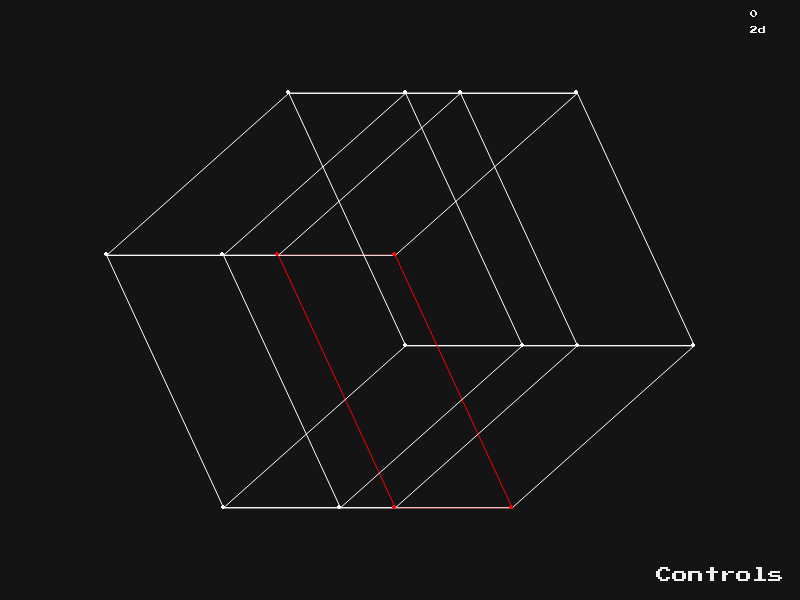

# Interactive Hypergeometry

An interactive wireframe viewer for 3D–6D objects, with orthographic and perspective
projections and highlighted subobjects.



## Run

Requires Python 3.10+.

```sh
python -m venv .venv
source .venv/bin/activate       # Windows: .venv\Scripts\activate
python -m pip install -r requirements.txt
python main.py presets/4dcube.txt visualisators/4d_orthographic.txt
```

Use `4d_perspective.txt` for perspective projection. The 5D and 6D cubes have
matching `5d_default.txt` and `6d_default.txt` visualisators.

Running without arguments opens file pickers, which require Tk. Command-line
presets work without Tk. Hover over **Controls** for the original in-app help.

| Key | Action |
| --- | --- |
| Space | Pause / resume |
| Q / E | Step backward / forward |
| W / S | Cycle highlighted subobjects |
| A / D | Switch subobject groups |
| Mouse wheel | Zoom |
| I | Import or reload object and visualisator |
| N / M | Write an object / visualisator template to a selected file |
| Esc | Quit |

The original colors, font, controls, animation increments, and text file formats
are retained. Rotation and projection now operate on point arrays, screen
coordinates are calculated once per frame, and repeated text is cached. Wire
edges use antialiasing. Points at projection singularities are omitted.

## Checks

```sh
python -m unittest discover -s tests -v
python tools/benchmark.py --preview docs/preview.png
```

Tests compare the optimized math against the original point-by-point calculations
for all bundled presets, and exercise the existing controls. The benchmark measures
update/drawing work without the display's frame cap.

Original documentation: [dokumentacia.pdf](dokumentacia.pdf), in Slovak.
